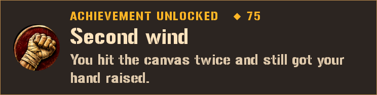

# FightNight3OGX

Play the original Xbox edition of *Fight Night Round 3* on Android. On an AYN Thor, the top screen carries the widescreen broadcast and the bottom screen puts you in the corner. Check who’s landing the cleaner punches, treat a swollen eye between rounds, then scout the next opponent for your career boxer.

> **Bring your own disc.** You’ll need your own North American original Xbox *Fight Night Round 3* ISO. The app reads `default.xbe` from your disc and recompiles it on your Android device. The APK and this repository omit the retail executable, fighters, arenas and original EA Trax recordings. FightNight3OGX is an independent fan project. Electronic Arts has no affiliation with it and does not endorse it.

**[Download the Android APK](https://github.com/Oxide-Shift/FightNight3OGX/releases)** · [Getting started](#getting-started) · [Bring your career save](#bring-your-career-save)

## What do you get over emulation?

### Fight the round, then work the corner

Gatti and Ward are trading in the screenshot above. The punch totals below tell you whether all that pressure is paying off. You can check both fighters’ stamina and the round clock without pausing the bout.

At the bell, pick **Manual** to take the cutman’s stool. Choose the injured side and a treatment on the lower screen, then sweep across the pad. Watch the swelling on your boxer’s face up top while the seconds tick down.

### Build a career between bouts

Before you sign a contract, compare the purse and your opponent’s record, then check the scouting report for an advantage in power, speed or stamina. The Fight Store uses the same two-screen setup. Try on the gloves up top and see what the purchase would leave in your wallet below.

*Two example career screens. On the left, the scouting report sizes up Micky Ward. On the right, a $1,200 purchase would leave $2,250 for the rest of camp.*

At the heavy bag, the upper screen shows the drill while the training sheet below lists the projected changes across eight attributes. After the session, check what your boxer actually gained.

### Chase all 100 achievements

Open **Achievements** in the Xbox main menu. Get off the canvas and win for *Back from the canvas*, land at least 75% of 40 or more punches for *Thread the needle*, or take a career boxer to 10–0 for *Unblemished*. There are **100 illustrated awards** worth **6,155 Fight Score**, including eight classic Xbox 360 career awards with their original point values. When a badge pops, the ribbon shows its score and the feat that earned it. Your unlocks travel with your career backup.

*Second wind is worth 75 points. You can get dropped twice and still leave the ring with something to show for it.*

### Take EA Trax into the ring

Open **Music** in the main menu to carry EA Trax into fights. The song stays at entrance volume through the walkouts and drops to 12% when the opening round clock starts. Turn on **FN3 Expanded Music** to add seven tracks by FN3OGX, including *Blood + Sweat* and *The Contender*.

## Picture and performance

The launcher offers 30, 45 and 60 FPS targets, VSync and a choice of widescreen or original 4:3. For a sharper picture on Thor, select **Vulkan → 1080p → High**. High sharpens the image and uses 4× texture filtering, with optional 2× MSAA for smoother edges. Frame rate varies by venue and can dip during exchanges.

The **AYN Thor** is the only handheld tested for dual-screen play. On a single-screen Android device, menu prompts stay on the main display.

## Getting started

You’ll need **ARM64 Android 11 or newer** and your own **North American original Xbox *Fight Night Round 3* ISO**. The app prepares the game on the handheld using the executable, fighters, arenas, footage and EA Trax from your disc.

1. Download the APK under **Assets** on the [GitHub Releases page](https://github.com/Oxide-Shift/FightNight3OGX/releases) and install it on your handheld.
2. Open **Fight Setup** and choose a career backup folder you can find again after a reinstall.
3. Tap **Choose Xbox ISO** and keep Fight Setup open while it prepares the game. Selecting a local, seekable ISO avoids a second 7.83 GB copy. If your file provider streams the ISO, allow about **11 GB free** in addition to the ISO.
4. Choose your picture and frame-rate settings, then tap **Enter the ring**. Later launches reuse the prepared game. Use **Check for updates** in the launcher for new releases.

## Bring your career save

Already have a boxer in hakuX? Open **Save & sound → Import Xbox save** and select your exported career. FightNight3OGX keeps timestamped backups for each Xbox profile, including shared settings and achievement progress. You can see the last completed backup or change its destination under **Save & sound**.

After reinstalling, select the same backup folder to restore the newest usable career. To switch profiles or roll back to an earlier fight, use **Import Xbox save** and select the backup you want.

---

## Made with AI

I wanted to play the Xbox version of *Fight Night Round 3* on my AYN Thor and use the bottom screen to work the corner between rounds. I directed the project and tested it on my Thor. OpenAI’s Codex helped write the port, launcher and touchscreen features. The recompilation tools this builds on are credited in the [development notes](docs/DEVELOPMENT.md).

[Build and test from source](docs/DEVELOPMENT.md) · [Achievement bell credit and license](third-party/BoxingBell.txt)
