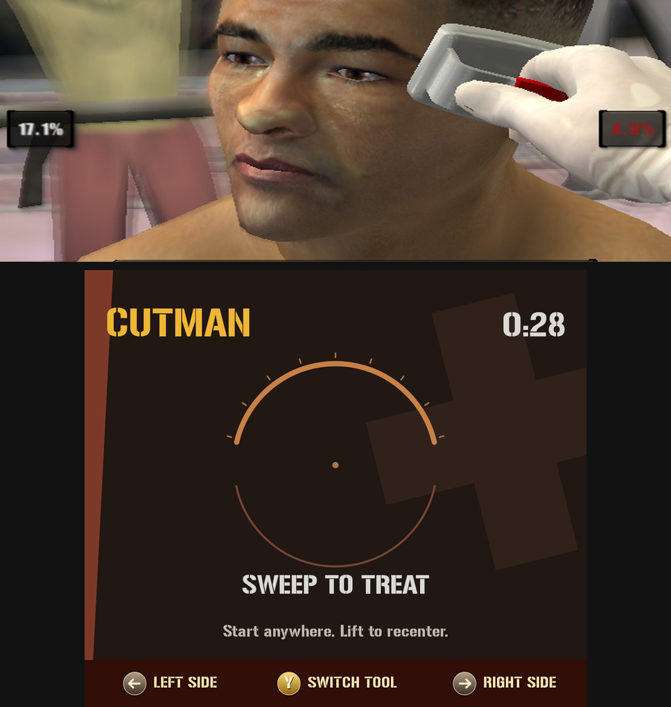

> **AI Disclaimer.** I wanted to play the Xbox version of *Fight Night Round 3* on my AYN Thor and use the bottom screen to work the corner between rounds. I directed the project and tested it on my Thor. OpenAI’s Codex helped write the port, launcher and touchscreen features.

---

# FightNight3OGX

Play the original Xbox edition of *Fight Night Round 3* on Android. On an AYN Thor, the broadcast stays on the upper screen while the lower screen becomes your corner. See who’s winning the exchanges, work on a cut between rounds, and scout the next opponent for your career boxer.

**[Download for Android](https://github.com/Oxide-Shift/FightNight3OGX/releases/latest)** · [Supported game](#supported-game) · [Getting started](#getting-started) · [Bring your career save](#bring-your-career-save)

> **Bring your own disc.** You’ll need your own North American original Xbox *Fight Night Round 3* ISO. The app recompiles `default.xbe` on your Android device. The APK and this repository omit the retail executable, fighter and arena data, and original EA Trax recordings. FightNight3OGX is an independent fan project. Electronic Arts has no affiliation with the project and does not endorse it.

Gatti has landed 9 of 16 punches. Ward has landed 9 of 12. A glance down tells you who’s connecting more often and how much stamina each fighter has left. When the judges turn in a round, their scores appear below the punch totals.

## Supported game

| Field | Tested copy |
| --- | --- |
| Game | Fight Night Round 3 |
| Platform | Original Xbox (NOT Xbox 360 or PS2) |
| Region | USA / NTSC-U |
| Disc ID | `EA13402A` |
| Xbox Title ID | `45410086` |
| Release | Original (XBE Version 2) |
| ISO format | Full-size Xbox XGD1 (7.29 GiB) |

**Verified SHA-256 of `default.xbe` inside the ISO**

`cfaf2d2c1c338a6e4e7135466c8dcb80fdf7da63682e71cfecdcba65b3682064`

**Compatibility note**

This is the exact game version tested with FightNight3OGX Alpha 61. Other regions or revisions haven't been verified yet.

If your ISO isn't recognized, please share the exact launcher error and whether you're using a Redump ISO or XISO.

## Getting started

You’ll need **ARM64 Android 11 or newer**. The **AYN Thor** is the only handheld tested for dual-screen play. On a single-screen device, menu prompts stay on the main display.

1. Install the APK listed under **Assets** on the [latest release](https://github.com/Oxide-Shift/FightNight3OGX/releases/latest).
2. Open **Fight Setup** and choose a career backup folder you can find again after a reinstall.
3. Tap **Choose Xbox ISO** and select your disc image. Keep Fight Setup open while the app extracts and compiles the game. If **Prepare game** appears, tap it to finish. A local file the app can read directly avoids a second full-size ISO copy. If your file provider streams the ISO, allow about **11 GB free** in addition to the disc image.
4. Choose your picture settings and tap **Enter the ring**. Later launches reuse the prepared game. Use **Check for updates** in Fight Setup for future releases.

**Updating to Alpha 63?** Your imported disc and saves carry over. Let Fight Setup rebuild the game code once after you update. Alpha 63 fixes a half-second audio wait captured during punch exchanges on the Thor.

See Fight Setup and picture settings

The launcher offers **30, 45 and 60 FPS** targets, VSync, widescreen and original 4:3. The example uses Vulkan at **1080p, High**, with sharpening, 4× filtering and 2× MSAA. Under **Advanced graphics**, you can change edge smoothing or turn on **Show FPS counter**. It starts off. When enabled, small neon-green digits in the upper-left of the game screen show the displayed frame rate. Pause menus and the lower-screen results stay clear. Frame rate varies by venue and can dip during exchanges.

**Why stop at 60 FPS?** The original round timer counts game updates. In an isolated test at normal clock speed, doubling the update rate made a three-minute round run out in 90 seconds. Alpha 63 keeps the original fight timing. The intro, fighter entrances, highlights, coach’s corner and post-fight sequences use 30 FPS pacing.

## Work the corner

At the bell, choose **Manual** to take the cutman’s stool. Watch the boxer’s face on the upper screen while you select a side, switch between treating cuts and swelling, and sweep across the lower touchscreen. Lift your finger to recenter for the next stroke.

On a Thor, the purple handheld marks Player 1 on **Select Corner**. Move it to blue or red before choosing your boxer. The same handheld appears under **Select Controller** when you pause a fight.

The red-orange Thor loading guide follows the control configuration you selected in the game. In configurations 1–4, **R2 blocks**. In 5–6, **R2 punches** and the **right stick blocks**. The two face-button diagrams let you read the guide in either Thor or Xbox button order.

See the Thor controls for configuration 3

## Chase all 100 achievements

Open **Achievements** in the game’s main menu. Seven shelves hold **100 illustrated awards worth 6,155 Fight Score**, including the eight Xbox 360 career awards with their original point values. Flip shelves with the bumpers or tap **Prev** and **Next** on the lower screen.

*Second wind* pays **75** for getting knocked down twice and still winning. For a longer career chase, *Zero on the ledger* pays **125** for reaching 50 wins with no losses or draws. Each unlock ribbon shows the title, the points and what you did to earn them.

## Build a career between bouts

Before signing a contract, compare the purse and your opponent’s record, power, speed and stamina. In the Fight Store, try equipment on your boxer up top and check what the purchase would leave in your wallet below.

**Career → Edit Boxer** moves the field, tab and help prompts to the lower screen. On the ring identity page, tap **Edit name** to change the selected name field. At the heavy bag, you can preview the trade-offs across eight attributes before training and review the actual gains afterward.

See the boxer editor and heavy-bag training

## Take EA Trax into the ring

Open **Music** in the game’s main menu. Both options start **off** on a new install.

| Option | What you’ll hear |
| --- | --- |
| **Music during fights** | The song carries through loading, walkouts and announcements. When the opening round clock starts, the music fades to 12% volume. |
| **FN3 Expanded Music** | Seven tracks by FN3OGX join the EA Trax rotation, including *Blood + Sweat*, *Corner Talk* and *The Contender*. |

See the in-game Music menu

## Bring your career save

- **From hakuX.** Export your Fight Night save as a ZIP. In Fight Setup, open **Save & sound → Import Xbox save** and tap **Choose ZIP**. The imported career opens in a separate slot.
- **After reinstalling.** Select the same backup folder on a fresh install to restore the newest usable career. Backups are timestamped by Xbox profile and include shared settings and achievement progress.
- **Back to hakuX.** Choose **Save & sound → Export save** to write a compatible ZIP. You can also import an earlier backup to return to that point in your career.

[Development notes, build instructions and tool credits](docs/DEVELOPMENT.md) · [Achievement bell credit and license](third-party/BoxingBell.txt)
