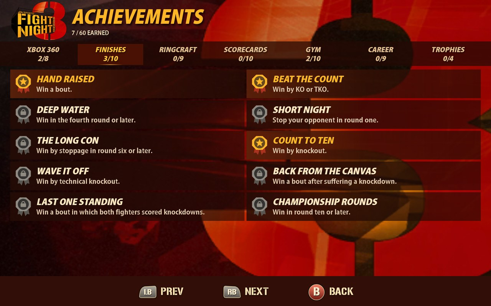

# FightNight3OGX

**The original Xbox version of *Fight Night Round 3*, running natively on Android.** Bring your own disc, build your boxer and work your way onto the televised card. FightNight3OGX adds 60 achievements to chase and, on a dual-screen handheld, gives your corner a job between bells.

[**Download FightNight3OGX for Android**](https://github.com/Oxide-Shift/FightNight3OGX/releases) · [Achievements](#the-achievement-cabinet) · [Inside the corner](#between-bells) · [Installation](#get-in-the-ring)

*Gatti and Ward trade punches up top. Down below, you can see who’s throwing more, who’s landing and how much gas each fighter has left.*

## The achievement cabinet

Get off the canvas and come back to win for **Back from the canvas**. Land 75% of at least 40 punches for **Thread the needle**. Take a career boxer to 10–0 and **Unblemished** is yours.

The **Achievements** entry sits right in the game’s main menu. Its seven shelves hold **52 original challenges** and **eight classic Xbox 360 career awards** worth **1,000 G** in your local cabinet. Every award has its own illustrated boxing badge. A bell rings as your badge and achievement title slide into view. Flip shelves with LB and RB or use the lower touchscreen. Your awards travel with your career backup.

*The Finishes shelf, with sample unlocks and its lower-screen button prompts.*

## Between bells

On the **AYN Thor**, the tested dual-screen handheld, the upper display stays with the broadcast. The lower display follows the fight, from punch stats and round scores to the cutman’s stool. Pick **Manual** between rounds, choose a treatment and swipe over the injured side while the clock runs down. On single-screen Android devices, the game keeps its menu prompts on the main display.

## Career Central

- **Contracts.** Compare purses, records, power, speed and stamina. Tap a matchup for a scouting report before you sign.
- **Training camp.** See which attributes a drill can raise or cost you, then compare the estimate with what your boxer actually gained.
- **Fight Store.** Preview the gloves on your fighter while the lower screen shows the price and what you’ll have left for a trainer.

*The contract desk and Fight Store with sample career data.*

*The heavy bag drill with its training sheet on the lower screen.*

## Picture and sound

Select **Vulkan, 1080p, High and a 60 FPS target** for the sharpest Thor preset. High adds sharpening and 4× texture filtering. **VSync** starts on. You can toggle it, enable 2× MSAA or choose a 30 or 45 FPS target. Actual frame rate depends on the device and the action in the ring.

Open **Music** beside **Achievements** in the Xbox main menu. **Music during fights** carries the current song through loading, walkouts and rounds at 12% volume. **FN3 Expanded Music** adds seven tracks by **FN3OGX** to the rotation, from *Blood + Sweat* to *The Contender*. The EA Trax strip announces each song. You can turn either option on independently.

The launcher's Ring Focus tracks crossfade quietly. On Thor, six controller-loading screens also show the handheld alongside the game's original prompts.

## Get in the ring

You’ll need **ARM64 Android 11 or newer** and your own **North American original Xbox *Fight Night Round 3* ISO**. The app compiles the game locally. The executable, fighters, arenas, broadcast footage, menu audio and EA Trax come from your disc.

1. Open the [releases page](https://github.com/Oxide-Shift/FightNight3OGX/releases), download the Android APK under **Assets** and install it.
2. When Fight Setup asks where to back up your career, choose a folder you can find again. A folder such as **Documents/FightNight3OGX Saves** works well.
3. Tap **Choose Xbox ISO**, select your disc and keep Fight Setup open through preparation. A local, seekable ISO skips a second 7.83 GB copy. Allow about **11 GB free** beyond the ISO if your file provider only supports streaming.
4. Choose your graphics settings and tap **Enter the ring**.

A full fresh install on a Thor Pro took **1 minute 39 seconds** on Alpha 46. Fight Setup shows the time on your device. Later launches reuse the prepared game. The launcher checks GitHub for updates and asks before installing. Updates reuse compatible builds and relink or recompile when needed.

### Keep your career

Each Xbox profile gets a folder with its in-game name. For example, a profile named **User** gets timestamped backups in **User/**. Switch profiles and that player's saves go into their own folder. Each verified ZIP is a complete restore point for that profile, including shared game settings and cabinet awards. Check the last completed backup or change its destination under **Save & sound**. If you skip choosing a folder, backups go to **Downloads/Fight Night Round 3**.

After a reinstall, choose the same backup folder. Fight Setup selects the newest usable career across its profile folders and older loose ZIPs. To play another profile or roll back, open **Import Xbox save** and choose a different backup. Fight Setup can also import a hakuX career.

[Build and test from source](docs/DEVELOPMENT.md) · [Achievement bell recording and license](third-party/BoxingBell.txt)
