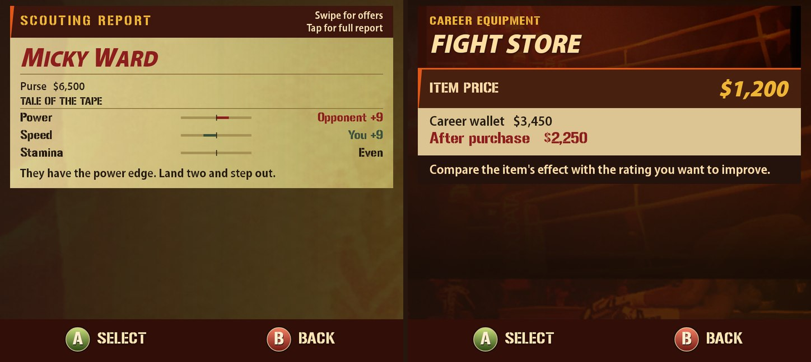

# Fight Night Round 3 on AYN Thor

Build a boxer from their first contract to a televised title fight. Between bells, use the lower touchscreen to work the swelling over your fighter’s eye. Back in Career Central, scout the next opponent, price a pair of gloves and decide whether you can still afford a trainer.

**FightNight3OGX** brings the original Xbox game to ARM64 Android, with a dual-screen corner built for the AYN Thor, **60 built-in achievements**, and a **1080p, High graphics, 60 FPS target** with optional **VSync**. The game runs locally from your own disc.

[**Download the Android APK**](https://github.com/Oxide-Shift/FightNight3OGX/releases) · [Achievements](#the-achievement-cabinet) · [Career Central](#career-central) · [Install on your handheld](#install-on-your-handheld)

## The achievement cabinet

Get knocked down, get up and win. That earns **Back from the canvas**. Land 75% of at least 40 punches in a bout for **Thread the needle**, or take a career boxer to ten wins without a loss for **Unblemished**. A boxing bell and an unlock ribbon mark the moment.

**Achievements** is a built-in mod with its own entry on the game’s main menu, between **Create Champ** and **Options**. Its seven shelves hold **52 new challenges** and the **eight classic Xbox 360 career awards**. Those eight are worth **1,000 G** in the local cabinet. Browse with the shoulder buttons, the D-pad or the lower touchscreen. Progress saves on the device.

*The Finishes shelf and lower-screen controls, shown together with sample unlocks.*

## Between rounds, you’re the cutman

Watch the punches land up top. A glance down tells you how many got through, how much stamina is left and how the judges have scored the completed rounds. When your boxer comes back to the stool, choose **Manual**. Pick the injured side, switch treatment and **sweep your finger across the lower screen**. Watch the cutman work on the upper screen while the corner clock counts down.

## Career Central

- **At the contract table**, swipe through offers. Compare the purse, records, power, speed and stamina. Tap a matchup for the full scouting report before signing.
- **In the gym**, highlight a drill to see which attributes can rise and which can fall. Compare the estimate with the actual gains after the session. When hiring a trainer, check the fee against your wallet.
- **At the Fight Store**, preview gear on your boxer while the lower screen shows the highlighted item’s price, your cash and what you’ll have left. If you’re short, it shows how much more you need.

*The contract desk and Fight Store, shown with sample career data.*

*Career training in an earlier build. The training sheet follows the drill selected above.*

## Saves and sound

After you save a career, open **Files → Downloads → Fight Night Round 3** for the latest two ZIP backups of that slot. Each includes your Xbox profile and unlocked achievements. After reinstalling, choose **Fight Setup → Import Xbox save → Choose ZIP** to bring them back. The latest backup is listed under **Save & sound**.

**Ring Focus during fights** adds the launcher soundtrack under live rounds at 4% volume. It starts off. On a Thor, six controller-loading screens now illustrate the handheld alongside the original game prompts.

## Fight Setup

On a Thor, select **Vulkan · 1080p · High · 16:9 · 60 FPS**. High adds sharpening and 4× texture filtering. Advanced graphics offers 2× MSAA for smoother edges. **VSync** is on by default and can be toggled independently. You can also choose a 30 or 45 FPS target. Frame rate varies by device and by the action in the ring.

The Thor is the tested dual-screen handheld. With one display, the game keeps its menu prompts on the main screen. Fight Setup also supports controller rumble, save import and export, and importing a hakuX career.

## Install on your handheld

You’ll need **ARM64 Android 11 or newer**, your own **North American original Xbox Fight Night Round 3 ISO**, and space for the extracted game and compiler. Choosing a local, seekable ISO skips the extra 7.83 GB image copy. For stream-only file providers, allow about **11 GB free** in addition to the ISO.

1. Download the versioned **FightNight-Round3-Thor** APK under **Assets** on the [releases page](https://github.com/Oxide-Shift/FightNight3OGX/releases). Open it on the handheld and install it.
2. In **Fight Setup**, tap **Choose Xbox ISO** and select your image. Follow the preparation prompt and keep the app open through extraction, translation and compilation.
3. Choose your display settings and tap **Enter the ring**.

The previous Thor Pro cold preparation took about **three minutes**. Alpha 46 overlaps disc extraction with compilation. Fight Setup reports translation, compile-and-link and total time on your device. The APK supplies the Android app, runtime and compiler. The game executable, textures, fonts, movies, menu sounds and EA Trax soundtrack come from your disc.

### Updating

Fight Setup checks GitHub releases and prompts when a newer matching APK is available. You can also select **Check for updates**. Install over the existing app to keep your disc import and career saves. Standard builds reuse a compatible prepared game. A runtime update can relink cached objects, while a compiler or translation change can require a full preparation. Choose **Time another full build** to benchmark a fresh compiler run using the installed disc.

[Build and test from source](docs/DEVELOPMENT.md) · [Achievement bell recording and license](third-party/BoxingBell.txt)
