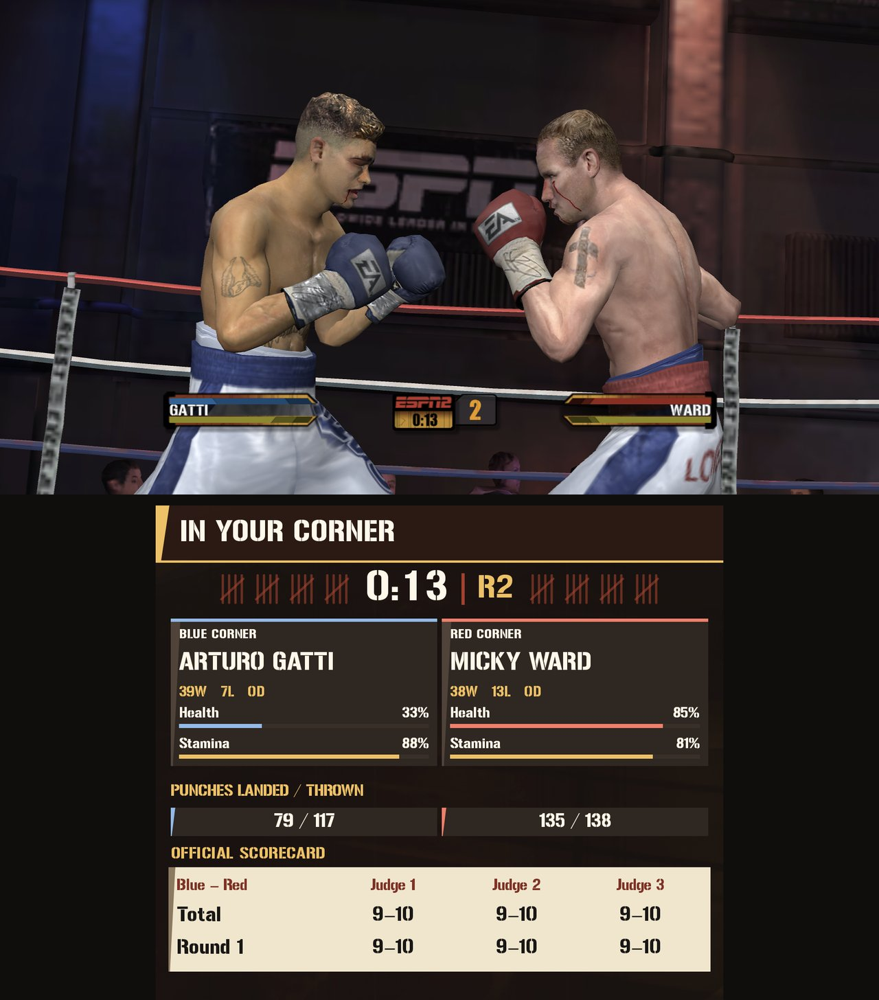
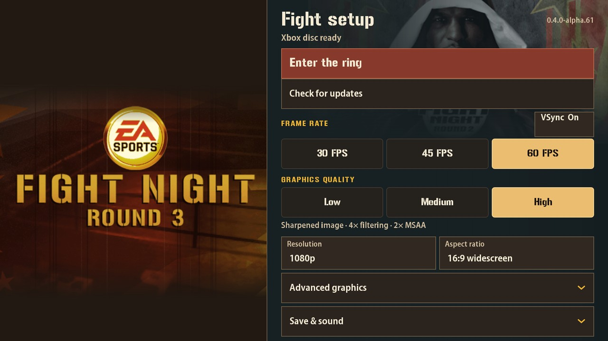
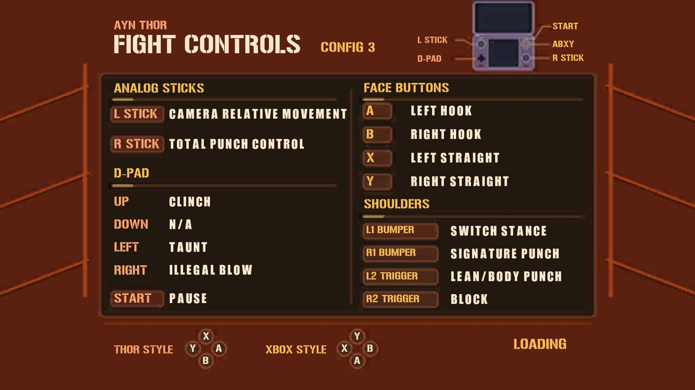
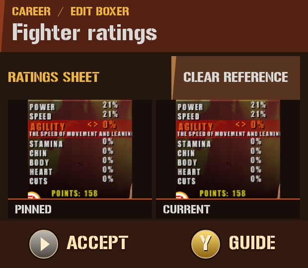
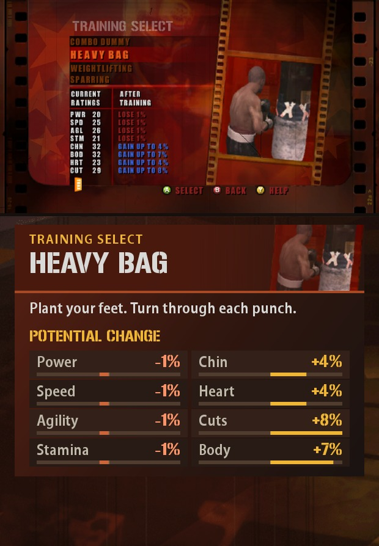
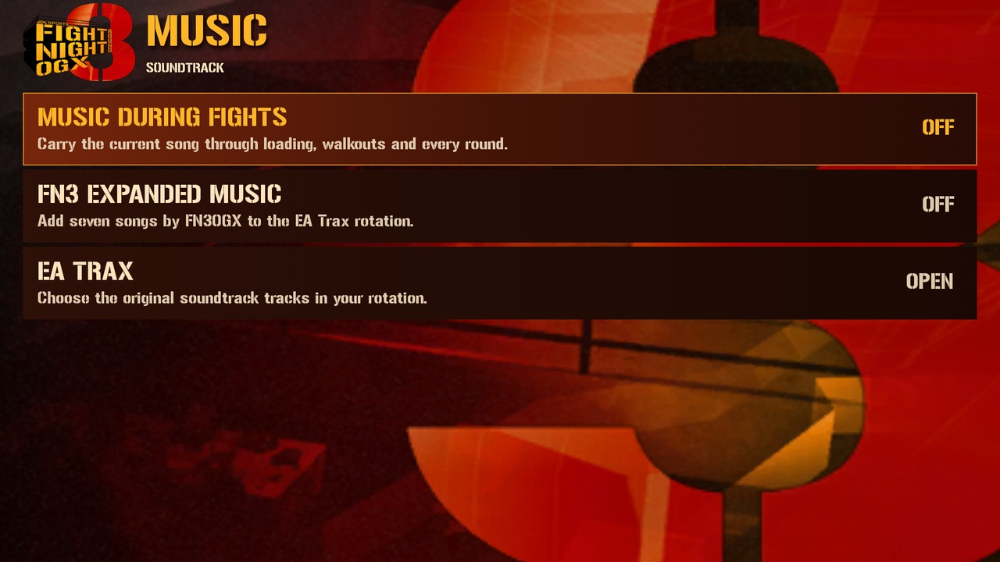

> **AI Disclaimer.** I wanted to play the Xbox version of *Fight Night Round 3* on my AYN Thor and use the bottom screen to work the corner between rounds. I directed the project and tested it on my Thor. OpenAI’s Codex helped write the port, launcher and touchscreen features.

---

# FightNight3OGX

Play the original Xbox edition of *Fight Night Round 3* on Android. On an AYN Thor, the broadcast stays on the upper screen while the lower screen becomes your corner. See who’s winning the exchanges, work on a cut between rounds, and scout the next opponent for your career boxer.

**[Download for Android](https://github.com/Oxide-Shift/FightNight3OGX/releases/latest)** · [Supported game](#supported-game) · [Getting started](#getting-started) · [Bring your career save](#bring-your-career-save)

> **Bring your own disc.** You’ll need your own North American original Xbox *Fight Night Round 3* ISO. The app recompiles `default.xbe` on your Android device. The APK and this repository omit the retail executable, fighter and arena data, and original EA Trax recordings. FightNight3OGX is an independent fan project. Electronic Arts has no affiliation with the project and does not endorse it.

Gatti has landed 9 of 16 punches. Ward has landed 9 of 12. A glance down tells you who’s connecting more often and how much stamina each fighter has left. When the judges turn in a round, their scores appear below the punch totals.

## Supported game

| Field | Tested copy |
| --- | --- |
| Game | Fight Night Round 3 |
| Platform | Original Xbox (NOT Xbox 360 or PS2) |
| Region | USA / NTSC-U |
| Disc ID | `EA13402A` |
| Xbox Title ID | `45410086` |
| Release | Original (XBE Version 2) |
| Tested image formats | Full-size Xbox XGD1 (7.29 GiB) and compact XISO (2.24 GiB) |

**Verified SHA-256 of `default.xbe` inside the ISO**

`cfaf2d2c1c338a6e4e7135466c8dcb80fdf7da63682e71cfecdcba65b3682064`

**Compatibility note**

Fight Setup accepts both the full-size US disc and the compact US XISO. We compared an independently distributed XISO and one rebuilt locally against the full disc. All 901 game files matched by SHA-256. The independently distributed XISO is 2,405,171,200 bytes and its whole-image SHA-1 is `9c7a817964b6334869831f669af5a6be6e23fef2`. Other XISO layouts can have different sizes and hashes while containing the same game.

Identify a full-size original Xbox disc by its hash

Both cataloged images are 7,825,162,240 bytes and use Xbox title ID `45410086`.

| Disc | CRC-32 | Whole-ISO MD5 | Whole-ISO SHA-1 |
| --- | --- | --- | --- |
| USA · `EA13402A` | `8f7ab94f` | `6fddb483d3de2723d088896919a5bb14` | `14ee949b26a77d071fc4776959e503b02f64114d` |
| Europe (English/French) · `EA13401E` | `b6b22b8b` | `7a712165d7d628bafb2436b28e57e00a` | `dd8941f8eb702ceb1fde2d612ab00b77c6d3562e` |

The European PAL release has a different `default.xbe` (MD5 `4f65d6d6e3d1ba717e4a9cbf8afc0a7b`). Its Android game build is pending. [Redump disc hashes](https://github.com/libretro/libretro-database/blob/master/metadat/redump/Microsoft%20-%20Xbox.dat) · [Original Xbox title database](https://mobcat.zip/XboxIDs/)

| Your copy | What to choose in Fight Setup |
| --- | --- |
| Full disc or compact XISO | Select the uncompressed `.iso`, `.xiso` or `.xiso.iso` directly. |
| ZIP, 7z or RAR archive | Choose a ZIP containing a single ISO or XISO directly. For 7z or RAR, extract the disc image first. |
| Compressed disc (`.cci`, `.cso`, `.chd`, `.zar`) or Games on Demand (SVOD) | Convert the original Xbox backup to a single uncompressed XISO first. |
| Split image (`.1.iso`, `.2.iso`, …) | Join the complete set using an Xbox image tool, then select the resulting XISO. |
| Extracted or HDD-ready game folder | Rebuild an XISO from the folder containing the game's `default.xbe` and assets. |

For conversion instructions, see [xemu's disc image guide](https://xemu.app/docs/disc-images/) and [XISO Studio's format guide](https://purelogiccode.github.io/XISOStudio/Usage-Guide.html). If import fails, share the exact launcher error and which image format you selected.

Fight Setup includes **Copy details** for unrecognized game revisions. It can restore a renamed dashboard title, edited disc-access or region flags, and trimmed trailing padding in its own copy of the US executable. It can also use a verified original stored as `default.xbe_orig` or `default.xbe.bak` beside an edited US executable. In every case the compiler receives the exact SHA-256 above.

If an import fails, Fight Setup explains the failure and offers **Choose another file**, **Copy details**, or **Send report**. A preparation failure offers **Prepare game** so you can retry using the installed disc. Each report requires your tap. The preview lists the app version, Android API, import stage, error code, image format and file size when available. For an unrecognized executable it also includes the available Xbox title ID, region mask, revision and SHA-256. The report contains diagnostic fields only. Your filename, game files and saves stay on your device. Approved reports can retry the next time Fight Setup is open.

If the project server accepts only error summaries, Fight Setup sends the error code, build and Android API first. It keeps the detailed report on your device and retries when the server supports it.

Fight Setup also checks the disc's menu archive (`GUI/overlay.viv`) before compiling and before launching an existing installation. If the file is missing or incomplete, select a complete disc image to repair the installed game. Your career saves are stored separately and survive the repair.

If the game starts and the crash dialog shows **game · exit 41**, your disc passed the import check. Alpha 73 fixes a startup menu error that produced this code before Press Start on verified US discs. If you saw it on an earlier build, update and try your existing import. Include the device model, the last screen you saw, and **Copy details** from that dialog when reporting it.

The crash dialog previews the device manufacturer, model and preferred CPU ABI. For a game crash it also shows the furthest startup or gameplay milestone reached, elapsed session time, last logged frame submission, selected frame-rate limit, anti-aliasing and filtering. For an invalid Xbox call it includes the attempted target and the guest stack return when available. **Send** delivers the displayed diagnostics to the project's private inbox. **Copy details** copies them locally, and **Skip** dismisses the report. Each submission has its own random receipt ID.

### What a diagnostic report can tell you

After an import failure or crash, **Copy details** gives you the same diagnostics you can preview and send to the private inbox. Each report requires your tap.

| Report section | What it can tell us |
| --- | --- |
| Game disc | The detected image layout, ZIP or raw container, sizes, Xbox title ID, certificate region and revision, and the SHA-256 of the original and installed executables. A fresh import also records whether it used the original XBE, restored certificate fields or alignment, or found a verified backup. |
| Game files | During extraction the launcher fingerprints the original contents of every file. The full USA ISO and compact USA XISO tested here both contain 901 files with the same combined SHA-256, `7c8ad7ead9c2dfd88d8d69fd3e1c066c2b80b53032294b4e64b6416208bbcefd`. This lets us compare repacked images. When the provider requires a full copy or ZIP unpack, the report also has SHA-1 for the complete streams read. |
| Device | Handheld model, Android release, CPU and SoC details, RAM and storage availability, display mode, advertised Vulkan version, thermal status and power-saving state when available. These values are sampled when the report is created. |
| Failure | The last event and round, observed startup milestone times, kernel imports resolved, renderer selected by the runtime, last logged frame and audio counters. For supported failures it identifies an Xbox instruction address, an Xbox stack word, or a native code offset. For a launcher crash, hang or low-memory exit, it uses Android's previous-process exit record when available. |

If you upgrade an existing installation, the launcher can still read its installed XBE and certificate. In the report preview, choose **More options → Check installed game files** to compare the whole installed game with the tested USA copy. This reads the files locally and returns you to the preview. Original container details require a fresh import. Your disc image, filenames, saves and raw logs stay on the device.

## Getting started

You’ll need **ARM64 Android 11 or newer**. The **AYN Thor** is the only handheld tested for dual-screen play. On a single-screen device, menu prompts stay on the main display.

1. Install the APK listed under **Assets** on the [latest release](https://github.com/Oxide-Shift/FightNight3OGX/releases/latest).
2. Open **Fight Setup** and choose a career backup folder you can find again after a reinstall.
3. Tap **Choose Xbox ISO** and select your disc image. Keep Fight Setup open while the app extracts and compiles the game. If **Prepare game** appears, tap it to finish. A local file the app can read directly avoids a second full-size ISO copy. If your file provider streams the ISO, allow about **11 GB free** in addition to the disc image.
4. Choose your picture settings and tap **Enter the ring**. Later launches reuse the prepared game. Use **Check for updates** in Fight Setup for future releases.

**Updating to Alpha 73?** Install the APK over your existing version. Fight Setup keeps your imported disc and career saves. If it offers **Prepare game**, let it finish before launching.

See Fight Setup and picture settings

The launcher offers **30, 45 and 60 FPS** targets, VSync, widescreen and original 4:3. The example uses Vulkan at **1080p, High**, with sharpening, 4× filtering and 2× MSAA. Under **Advanced graphics**, you can change edge smoothing or turn on **Show FPS counter**. It starts off. When enabled, small neon-green digits in the upper-left of the game screen show the displayed frame rate. Pause menus and the lower-screen results stay clear. Frame rate varies by venue and can dip during exchanges.

**Why stop at 60 FPS?** The original round timer counts game updates. In an isolated test at normal clock speed, doubling the update rate made a three-minute round run out in 90 seconds. The port keeps the original fight timing. The intro, fighter entrances, highlights, coach’s corner and post-fight sequences use 30 FPS pacing.

Press **Android Back** during a game to open Fight Setup. Choose **Resume bout** to return or **End session** to close the game. On the Thor, the **B face button** handles in-game navigation. In Options, B uses the Exit row’s save action. In Edit Boxer, it opens the game’s **Accept Changes** prompt.

Highlight a main-menu item to see what it offers on the lower screen. **Play Now** keeps a single exhibition description in place, **ESPN Classic** introduces the rivalries, and **Achievements** and **Music** explain their own menus before you open them.

## Work the corner

At the bell, choose **Manual** to take the cutman’s stool. Watch the boxer’s face on the upper screen while you select a side, switch between treating cuts and swelling, and sweep across the lower touchscreen. Lift your finger to recenter for the next stroke.

On a Thor, the purple handheld marks Player 1 on **Select Corner**. Move it to blue or red before choosing your boxer. The same handheld appears under **Select Controller** when you pause a fight.

The red-orange Thor loading guide follows the control configuration you selected in the game. In configurations 1–4, **R2 blocks**. In 5–6, **R2 punches** and the **right stick blocks**. The two face-button diagrams let you read the guide in either Thor or Xbox button order.

See the Thor controls for configuration 3

## Chase all 100 achievements

Open **Achievements** in the game’s main menu. Seven shelves hold **100 illustrated awards worth 6,155 Fight Score**, including the eight Xbox 360 career awards with their original point values. Flip shelves with the bumpers or tap **Prev** and **Next** on the lower screen.

*Second wind* pays **75** for getting knocked down twice and still winning. For a longer career chase, *Zero on the ledger* pays **125** for reaching 50 wins with no losses or draws. Each unlock ribbon shows the title, the points and what you did to earn them.

## Build a career between bouts

Before signing a contract, compare the purse and your opponent’s record, power, speed and stamina. In the Fight Store, try equipment on your boxer up top and check what the purchase would leave in your wallet below.

**Career → Edit Boxer** has a touch-only corner notebook. Pick a fight plan and mark off the tabs you’ve reviewed. The game keeps the boxer, the editing controls, and the **Accept Changes** prompt on the top screen. At the heavy bag, you can preview the trade-offs across eight attributes before training and review the actual gains afterward.

See the boxer editor and heavy-bag training

## Take EA Trax into the ring

Open **Music** from the game's main menu. The two music toggles start **off** on a new install. Select **EA Trax → Open** on the third row to open the original playlist editor. Press **B** to return to Music and **B** again to exit to the main menu.

| Music menu | What it does |
| --- | --- |
| **Music during fights** | The song carries through loading, walkouts and announcements. When the opening round clock starts, the music fades to 12% volume. |
| **FN3 Expanded Music** | Seven tracks by FN3OGX join the EA Trax rotation, including *Blood + Sweat*, *Corner Talk* and *The Contender*. |
| **EA Trax** | Choose which original soundtrack tracks are in rotation. |

See the in-game Music menu

## Bring your career save

- **From hakuX.** Export your Fight Night save as a ZIP. In Fight Setup, open **Save & sound → Import Xbox save** and tap **Choose ZIP**. The imported career opens in a separate slot.
- **After reinstalling.** Select the same backup folder on a fresh install to restore the newest usable career. Backups are timestamped by Xbox profile and include shared settings and achievement progress.
- **Back to hakuX.** Choose **Save & sound → Export save** to write a compatible ZIP. You can also import an earlier backup to return to that point in your career.

[Development notes, build instructions and tool credits](docs/DEVELOPMENT.md) · [Achievement bell credit and license](third-party/BoxingBell.txt)
