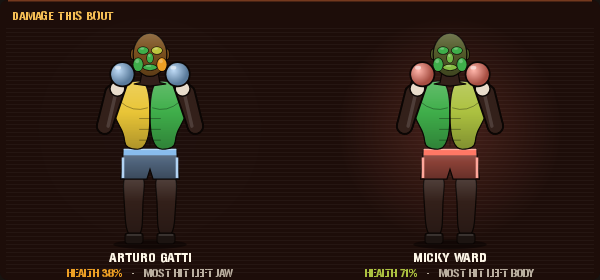
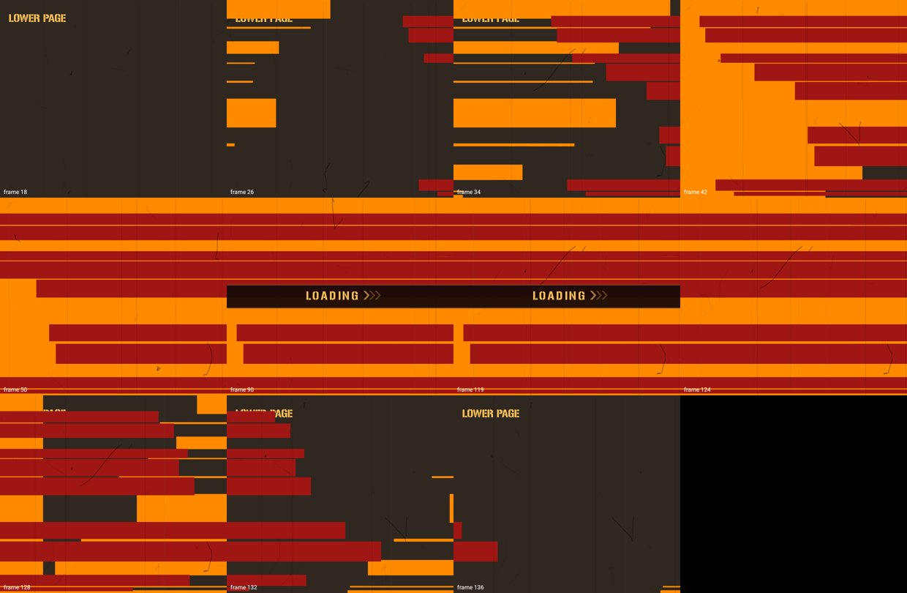
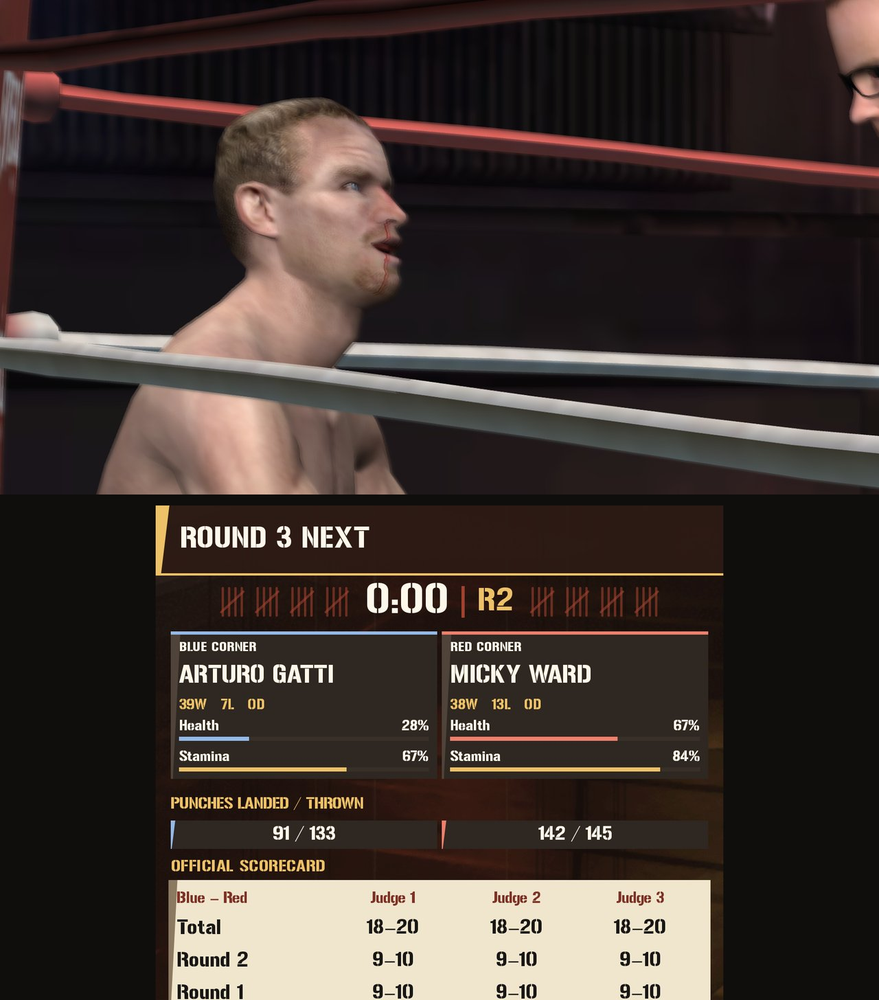
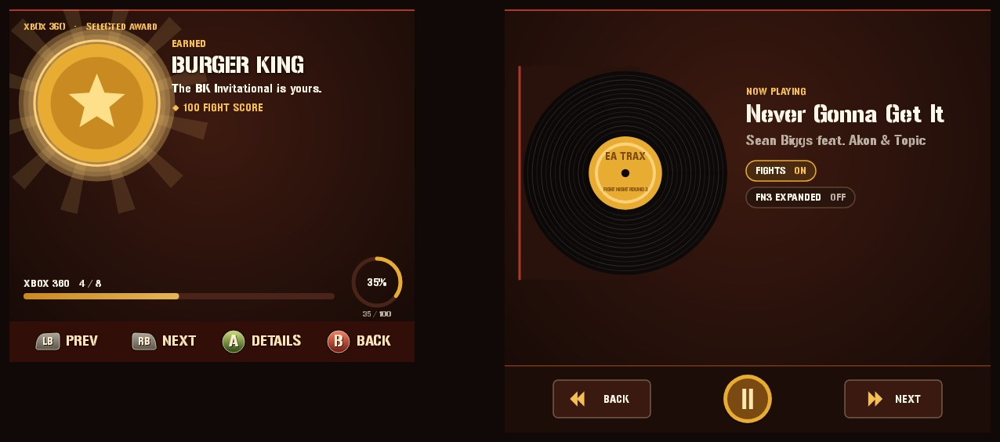
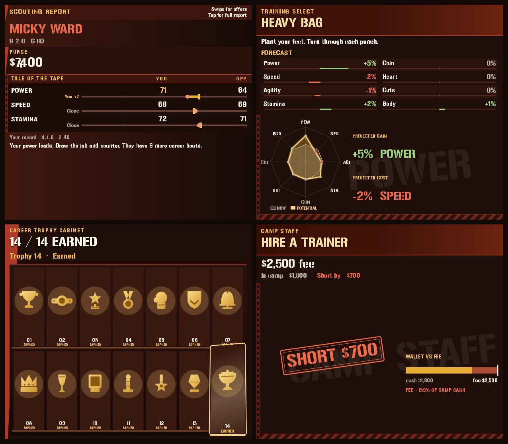

> **AI Disclaimer.** I wanted to play the Xbox version of *Fight Night Round 3* on my AYN Thor and use the bottom screen to work the corner between rounds. I directed the project and tested it on my Thor. OpenAI’s Codex and Anthropic’s Claude Code helped write the port, launcher and touchscreen features.

---

# FightNight3OGX

Play the original Xbox edition of *Fight Night Round 3* on Android. On an AYN Thor, the broadcast stays on the upper screen while the lower screen becomes your corner. See who’s winning the exchanges, work on a cut between rounds, and scout the next opponent for your career boxer.

**[Download for Android](https://github.com/Oxide-Shift/FightNight3OGX/releases/latest)** · [Supported game](#supported-game) · [Getting started](#getting-started) · [Bring your career save](#bring-your-career-save)

> **Bring your own disc.** You’ll need your own North American original Xbox *Fight Night Round 3* ISO. The app recompiles `default.xbe` on your Android device. The APK and this repository omit the retail executable, fighter and arena data, and original EA Trax recordings. FightNight3OGX is an independent fan project. Electronic Arts has no affiliation with the project and does not endorse it.

Round two, 13 seconds left. The lower screen keeps the clock and round on one centered line, flanked by ten round tacks per corner that light up in the fighter's colour for each round the judges give them. Below it: both records, health and stamina, punches landed and thrown, and every filed round on the official scorecard. Ward has landed 135 of 138. Gatti's health is down to 33%.

## Supported game

| Field | Tested copy |
| --- | --- |
| Game | Fight Night Round 3 |
| Platform | Original Xbox (NOT Xbox 360 or PS2) |
| Region | USA / NTSC-U |
| Disc ID | `EA13402A` |
| Xbox Title ID | `45410086` |
| Release | Original (XBE Version 2) |
| Tested image formats | Full-size Xbox XGD1 (7.29 GiB) and compact XISO (2.24 GiB) |

**Verified SHA-256 of `default.xbe` inside the ISO**

`cfaf2d2c1c338a6e4e7135466c8dcb80fdf7da63682e71cfecdcba65b3682064`

**Compatibility note**

Fight Setup accepts both the full-size US disc and the compact US XISO. We compared an independently distributed XISO and one rebuilt locally against the full disc. All 901 game files matched by SHA-256. The independently distributed XISO is 2,405,171,200 bytes and its whole-image SHA-1 is `9c7a817964b6334869831f669af5a6be6e23fef2`. Other XISO layouts can have different sizes and hashes while containing the same game.

Identify a full-size original Xbox disc by its hash

Both cataloged images are 7,825,162,240 bytes and use Xbox title ID `45410086`.

| Disc | CRC-32 | Whole-ISO MD5 | Whole-ISO SHA-1 |
| --- | --- | --- | --- |
| USA · `EA13402A` | `8f7ab94f` | `6fddb483d3de2723d088896919a5bb14` | `14ee949b26a77d071fc4776959e503b02f64114d` |
| Europe (English/French) · `EA13401E` | `b6b22b8b` | `7a712165d7d628bafb2436b28e57e00a` | `dd8941f8eb702ceb1fde2d612ab00b77c6d3562e` |

The European PAL release has a different `default.xbe` (MD5 `4f65d6d6e3d1ba717e4a9cbf8afc0a7b`). Its Android game build is pending. [Redump disc hashes](https://github.com/libretro/libretro-database/blob/master/metadat/redump/Microsoft%20-%20Xbox.dat) · [Original Xbox title database](https://mobcat.zip/XboxIDs/)

| Your copy | What to choose in Fight Setup |
| --- | --- |
| Full disc or compact XISO | Select the uncompressed `.iso`, `.xiso` or `.xiso.iso` directly. |
| ZIP, 7z or RAR archive | Choose a ZIP containing a single ISO or XISO directly. For 7z or RAR, extract the disc image first. |
| Compressed disc (`.cci`, `.cso`, `.chd`, `.zar`) or Games on Demand (SVOD) | Convert the original Xbox backup to a single uncompressed XISO first. |
| Split image (`.1.iso`, `.2.iso`, …) | Join the complete set using an Xbox image tool, then select the resulting XISO. |
| Extracted or HDD-ready game folder | Rebuild an XISO from the folder containing the game's `default.xbe` and assets. |

For conversion instructions, see [xemu's disc image guide](https://xemu.app/docs/disc-images/) and [XISO Studio's format guide](https://purelogiccode.github.io/XISOStudio/Usage-Guide.html). If import fails, share the exact launcher error and which image format you selected.

Fight Setup includes **Copy details** for unrecognized game revisions. It can restore a renamed dashboard title, edited disc-access or region flags, and trimmed trailing padding in its own copy of the US executable. It can also use a verified original stored as `default.xbe_orig` or `default.xbe.bak` beside an edited US executable. In every case the compiler receives the exact SHA-256 above.

If an import fails, Fight Setup explains the failure and offers **Choose another file**, **Copy details**, or **Send report**. A preparation failure offers **Prepare game** so you can retry using the installed disc. Each report requires your tap. The preview lists the app version, Android API, import stage, error code, image format and file size when available. For an unrecognized executable it also includes the available Xbox title ID, region mask, revision and SHA-256. The report contains diagnostic fields only. Your filename, game files and saves stay on your device. Approved reports can retry the next time Fight Setup is open.

If the project server accepts only error summaries, Fight Setup sends the error code, build and Android API first. It keeps the detailed report on your device and retries when the server supports it.

Fight Setup also checks the disc's menu archive (`GUI/overlay.viv`) before compiling and before launching an existing installation. If the file is missing or incomplete, select a complete disc image to repair the installed game. Your career saves are stored separately and survive the repair.

If the game starts and the crash dialog shows **game · exit 41**, your disc passed the import check. Alpha 73 fixes a startup menu error that produced this code before Press Start on verified US discs. If you saw it on an earlier build, update and try your existing import. Include the device model, the last screen you saw, and **Copy details** from that dialog when reporting it.

The crash dialog previews the device manufacturer, model and preferred CPU ABI. For a game crash it also shows the furthest startup or gameplay milestone reached, elapsed session time, last logged frame submission, selected frame-rate limit, anti-aliasing and filtering. For an invalid Xbox call it includes the attempted target and the guest stack return when available. **Send** delivers the displayed diagnostics to the project's private inbox. **Copy details** copies them locally, and **Skip** dismisses the report. Each submission has its own random receipt ID.

### What a diagnostic report can tell you

After an import failure or crash, **Copy details** gives you the same diagnostics you can preview and send to the private inbox. Each report requires your tap.

| Report section | What it can tell us |
| --- | --- |
| Game disc | The detected image layout, ZIP or raw container, sizes, Xbox title ID, certificate region and revision, and the SHA-256 of the original and installed executables. A fresh import also records whether it used the original XBE, restored certificate fields or alignment, or found a verified backup. |
| Game files | During extraction the launcher fingerprints the original contents of every file. The full USA ISO and compact USA XISO tested here both contain 901 files with the same combined SHA-256, `7c8ad7ead9c2dfd88d8d69fd3e1c066c2b80b53032294b4e64b6416208bbcefd`. This lets us compare repacked images. When the provider requires a full copy or ZIP unpack, the report also has SHA-1 for the complete streams read. |
| Device | Handheld model, Android release and firmware build, security patch level, CPU and SoC details, RAM and storage availability, every display's mode, advertised Vulkan version, thermal status, power-saving state, the app's build number, and connected controllers as USB vendor:product IDs (never their names). These values are sampled when the report is created. |
| Failure | The last event and round, observed startup milestone times, kernel imports resolved, the GPU name and driver version, renderer mode and graphics settings (including Pipelined frames), whether a fight was live or the device was asleep, recent frame timing, last logged frame and audio counters, and the last 40 lines of the game's own log with storage paths, file locations and anything resembling an email address removed. For supported failures it identifies an Xbox instruction address, an Xbox stack word, or a native code offset. For a launcher crash, hang or low-memory exit, it uses Android's previous-process exit record when available. |

If you upgrade an existing installation, the launcher can still read its installed XBE and certificate. In the report preview, choose **More options → Check installed game files** to compare the whole installed game with the tested USA copy. This reads the files locally and returns you to the preview. Original container details require a fresh import. Your disc image, filenames, saves and raw logs stay on the device.

## What's new in Alpha 81

- **Damage by region.** During rounds, between rounds and on the pause screen, the lower screen shows where each boxer has been hit: both eyes, nose, mouth, both jaws and both sides of the body, read from the game's own damage data. Each boxer is a silhouette that starts green and heats through yellow and orange to red as their health falls, with the most-hit area hottest and the colours recovering between rounds as health returns. Under each name: the boxer's health and the area taking the most punishment.
- **Smoother fights (81.3).** The crowd in the stands is now drawn on the graphics chip instead of the CPU. In testing on the Thor that removed about 5 ms of work from every frame and live rounds held 60 FPS where they had dipped to around 50.
- **Transitions on both screens.** When the game plays its red and orange transition, the lower screen plays the same bars in step with it, including on the Achievements and Music pages.
- **Redesigned career, Achievements and Music screens** with a darker Fight Night look and motion throughout (see below).
- **Music controls** on the lower screen: Back, Play/Pause and Next.
- **Notifications:** a larger EA Trax now-playing badge, and achievement unlocks that wait while a fight announcement is on screen.
- **Faster main menu** (60 FPS menus), arena lights behind the lower-screen menus, and the first song after Start comes in quickly.

Lower-screen transition, frame by frame. The Alpha 81 images in this README are rendered on a PC from the app's own screens with sample data, not captured on a Thor.

What was new in Alpha 80

- **A controller is required.** Fight Setup now says so when no gamepad is connected. There are no touch controls for boxing.
- **Lower-screen timekeeper:** one centered line, `1:42 | R1`, with a larger clock and tally-mark flanks.
- **Between rounds** the lower screen shows the next round, both fighters' health and stamina, punches, accuracy, your knockdowns, and up to two corner tips worked out from those numbers.

- **Steadier menu companion:** the lower screen no longer flashes "From your corner" while a submenu such as Play Now is open.
- **Clearer import messages:** a refused disc is labelled **Wrong platform**, **Different game**, **Unrecognized disc revision** or **Unsupported container**, and **Copy details** includes the `default.xbe` SHA-256.
- **Graphics driver resets** now return to Fight Setup with a plain message instead of an unexplained crash.
- **Pipelined frames** (Advanced graphics, off by default, experimental): the GPU renders one frame while the game prepares the next. On the Thor it raised live-round averages to about 59.5 FPS, but it adds one frame of display delay, had a worse single slowest frame in one venue, and can make the announcer's commentary choppy. Leave it off unless you want to experiment.
- Crash and import dialogs use the standard Android font.

## Getting started

You’ll need **ARM64 Android 11 or newer**. The **AYN Thor** is the only handheld tested for dual-screen play. On a single-screen device, menu prompts stay on the main display.

1. Install the APK listed under **Assets** on the [latest release](https://github.com/Oxide-Shift/FightNight3OGX/releases/latest).
2. Open **Fight Setup** and choose a career backup folder you can find again after a reinstall.
3. Tap **Choose Xbox ISO** and select your disc image. Keep Fight Setup open while the app extracts and compiles the game. If **Prepare game** appears, tap it to finish. A local file the app can read directly avoids a second full-size ISO copy. If your file provider streams the ISO, allow about **11 GB free** in addition to the disc image.
4. Choose your picture settings and tap **Enter the ring**. Later launches reuse the prepared game. Use **Check for updates** in Fight Setup for future releases.

**Updating an existing installation.** Install the new APK over the existing copy using the same Android profile. Keep your game data in place. A changed runtime can require **Prepare game** once. A soundtrack-only update reuses the prepared game. Use **Export save** or your chosen backup folder before changing devices.

### Startup and recovery

| What you see | What to do |
| --- | --- |
| Android refuses to install the APK | Use the complete release APK on a device with a 64-bit ARM Android system, API 30 or later. An update also needs the same package signature. Keep the installed copy and export your save if moving between differently signed builds. |
| The picker opens, but the disc cannot be read | Use Android's file picker to choose a single supported image. If the provider cannot keep the file available, copy it into local storage and choose that copy. Fight Setup requests access to the selected file. |
| **Wrong platform**, **Different game**, **Unrecognized disc revision** or **Unsupported container** | Wrong platform means an Xbox 360 or PlayStation image; Unsupported container means a 7z, RAR, compressed (CSO-style), split or ZAR file that must become a single ISO/XISO first. Check the edition and the SHA-256 of the **default.xbe inside the image** against Supported game. A whole-image hash can differ across valid repacks. Use **Copy details** to share the detected revision. |
| Preparation stops, or Android closes Fight Setup | Reopen the launcher and tap **Prepare game**. It can reuse the extracted disc. Free internal storage for a space error, or close other large apps if Android stopped the compiler. Keep the launcher open through the final check. |
| The screen goes black or the game returns to Fight Setup | Reopen Fight Setup and review the crash preview. Record whether you saw the logos, title screen, profile picker or first menu. Try Low graphics quality and 480p. Use **Copy details** or **Send report** with the original settings so the failure can be compared. |
| The lower screen is missing | Use the main display. The launcher routes supported prompts and controls according to the displays Android exposes. Full physical single-screen and non-Thor dual-screen coverage is still pending. |

The AYN Thor has been tested on Android 13. An Alpha 73 report from a Retroid Pocket 6 on Android 13 rendered 4,620 frames with Vulkan during startup and subsequently crashed. Verification of the newer candidate on that model remains open. Android version, ARM64 support and advertised graphics features alone do not establish that a particular device runs the game reliably.

See Fight Setup and picture settings

The launcher offers **30, 45 and 60 FPS** targets, VSync, widescreen and original 4:3. The example uses Vulkan at **1080p, High**, with sharpening, 4× filtering and 2× MSAA. Under **Advanced graphics**, you can change edge smoothing, try **Pipelined frames** (experimental: smoother averages, one frame of extra display delay, can make commentary choppy; off by default), or turn on **Show FPS counter**. It starts off. When enabled, small neon-green digits in the upper-left of the game screen show the displayed frame rate. Pause menus and the lower-screen results stay clear. Frame rate varies by venue and can dip during exchanges.

**Why stop at 60 FPS?** The original round timer counts game updates. In an isolated test at normal clock speed, doubling the update rate made a three-minute round run out in 90 seconds. The port keeps the original fight timing. The intro, fighter entrances, highlights, coach’s corner and post-fight sequences use 30 FPS pacing.

Press **Android Back** during a game to open Fight Setup. Choose **Resume bout** to return or **End session** to close the game. On the Thor, the **B face button** handles in-game navigation. In Options, B uses the Exit row’s save action. In Edit Boxer, it opens the game’s **Accept Changes** prompt.

Highlight a main-menu item to see what it offers on the lower screen. **Play Now** keeps a single exhibition description in place, **ESPN Classic** introduces the rivalries, and **Achievements** and **Music** explain their own menus before you open them.

## Work the corner

At the bell, choose **Manual** to take the cutman’s stool. Watch the boxer’s face on the upper screen while you select a side, switch between treating cuts and swelling, and sweep across the lower touchscreen. Lift your finger to recenter for the next stroke.

On a Thor, the purple handheld marks Player 1 on **Select Corner**. Move it to blue or red before choosing your boxer. The same handheld appears under **Select Controller** when you pause a fight.

The red-orange Thor loading guide follows the control configuration you selected in the game. In configurations 1–4, **R2 blocks**. In 5–6, **R2 punches** and the **right stick blocks**. The two face-button diagrams let you read the guide in either Thor or Xbox button order.

See the Thor controls for configuration 3

## Chase all 100 achievements

Open **Achievements** in the game’s main menu. Seven shelves hold **100 illustrated awards worth 6,155 Fight Score**, including the eight Xbox 360 career awards with their original point values. Flip shelves with the bumpers or tap **Prev** and **Next** on the lower screen.

The lower screen spotlights the award you've highlighted, with its medal, what it takes or what you did, and your progress in that category and overall.

*Second wind* pays **75** for getting knocked down twice and still winning. For a longer career chase, *Zero on the ledger* pays **125** for reaching 50 wins with no losses or draws. When you earn one, the medal strikes in on the lower screen and a short card shows the title, the points and what you did. If a fight announcement is on screen, the card waits for it instead of expiring unseen.

## Build a career between bouts

Before signing a contract, the scouting report shows the purse, any bonus objective, and a tale of the tape against your opponent. At training, an eight-point radar shows your current ratings and what the drill could change. The trophy case gives every trophy its own shape, and hiring a trainer or buying gear shows what it leaves in your wallet.

**Career → Edit Boxer** has a touch-only corner notebook. Pick a fight plan and mark off the tabs you’ve reviewed. The game keeps the boxer, the editing controls, and the **Accept Changes** prompt on the top screen.

## Take EA Trax into the ring

Open **Music** from the game's main menu. The two music toggles start **off** on a new install. Select **EA Trax → Open** on the third row to open the original playlist editor. Press **B** to return to Music and **B** again to exit to the main menu.

| Music menu | What it does |
| --- | --- |
| **On during fights** | The song carries through loading, walkouts and announcements. When the opening round clock starts, the music fades down so punches and breathing carry. |
| **FN3 Expanded** | Adds nine tracks credited to FN3OGX. *Still Want the Crown* opens the expanded selection on a fresh game launch, then the rotation shuffles. |
| **EA Trax** | Choose which original soundtrack tracks are in rotation. |

While the Music menu is open, the lower screen shows the song playing on a turning record, with **Back**, **Play/Pause** and **Next** keys. Back returns to the previous song, or restarts the current one.

## Bring your career save

- **From hakuX.** Export your Fight Night save as a ZIP. In Fight Setup, open **Save & sound → Import Xbox save** and tap **Choose ZIP**. The imported career opens in a separate slot.
- **After reinstalling.** Select the same backup folder on a fresh install to restore the newest usable career. Backups are timestamped by Xbox profile and include shared settings and achievement progress.
- **Back to hakuX.** Choose **Save & sound → Export save** to write a compatible ZIP. You can also import an earlier backup to return to that point in your career.

[Development notes, build instructions and tool credits](docs/DEVELOPMENT.md) · [Achievement bell credit and license](third-party/BoxingBell.txt)
