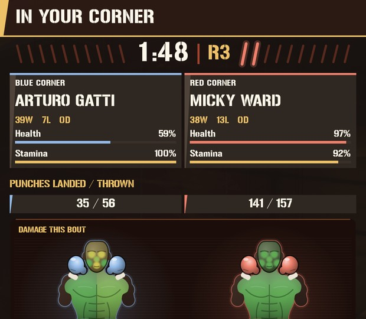
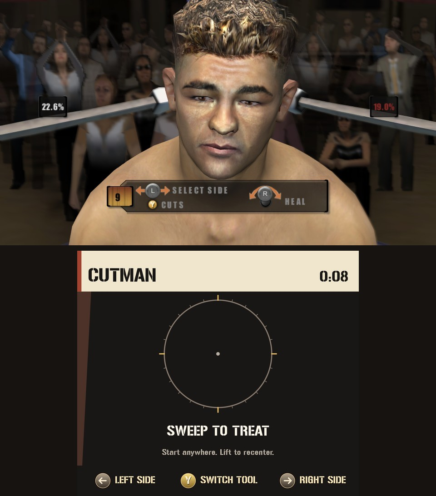
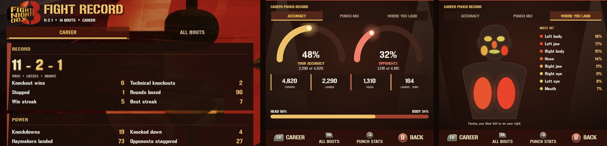
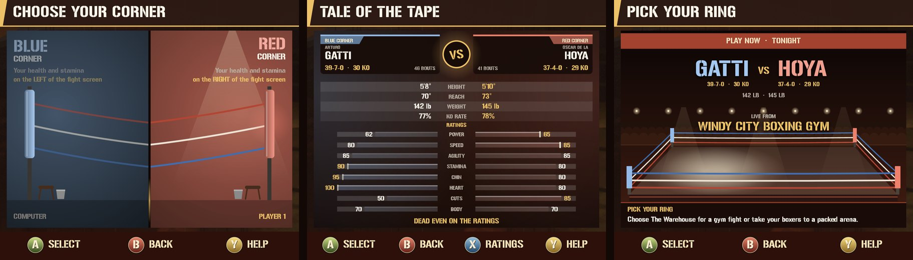
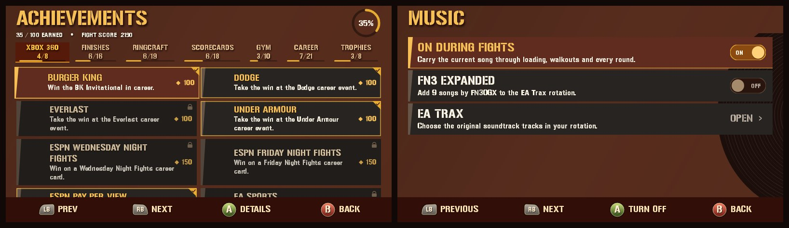

> **AI Disclaimer.** I wanted to play the Xbox version of *Fight Night Round 3* on my AYN Thor and use the bottom screen to work the corner between rounds. I directed the project and tested it on my Thor. OpenAI’s Codex and Anthropic’s Claude Code helped write the port, launcher and touchscreen features.

---

# FightNight3OGX

**The original Xbox *Fight Night Round 3*, rebuilt to run natively on Android, with a second screen that works your corner.**

The broadcast stays on the top screen. The bottom screen is ringside: the clock, both fighters' health and stamina, every punch landed, where each boxer is getting hurt, the judges' cards, and the cutman's stool between rounds.

**[⬇ Download for Android](https://github.com/Oxide-Shift/FightNight3OGX/releases/latest)** · [Why not just emulate it?](#why-not-just-emulate-it) · [Getting started](#getting-started) · [What's new](#whats-new-in-alpha-82)

Round one at Aragon on an AYN Thor. Ward has landed 47 of 54.

> **Bring your own disc.** You need your own North American original Xbox *Fight Night Round 3* ISO. The app recompiles the game on your device; the APK and this repository contain no game code, fighters, arenas or EA Trax recordings. FightNight3OGX is an independent fan project, not affiliated with or endorsed by Electronic Arts.

## Why not just emulate it?

Because this isn't an emulator. FightNight3OGX translates the game's own Xbox code into native Android code on your device, then runs it directly, and builds a whole second screen around it.

- **Runs like a native game.** 60 FPS fights at up to 1080p with widescreen, VSync, sharpening, MSAA and filtering. On the AYN Thor, live rounds hold 60 FPS. The original fight timing is kept, so rounds last as long as they should.
- **Your corner on the second screen.** A live HUD during rounds, a between-rounds report with corner tips, a damage map that heats up where each boxer is being hurt, and the official scorecard round by round.
- **Take the cutman's stool.** Choose Manual at the bell and treat cuts and swelling by sweeping the touchscreen while you watch the boxer's face up top.
- **A lifetime Fight Record.** Every bout counted: knockouts, knockdowns, staggers, streaks, accuracy, your punch mix and a heat map of where your punches land.
- **The tale of the tape before every Play Now fight.** Records, reach and all eight ratings head to head, read straight from the game's roster.
- **100 achievements**, including the eight Xbox 360 career awards, with their own shelves and a medal that strikes in when you earn one.
- **EA Trax in the ring**, plus nine expanded tracks, with now-playing and music keys on the lower screen.
- **Remap any button**, bring your career over from hakuX and back, back it up automatically, and update from inside the app.
- **Made for your device.** The controls guide and the corner-select icon show your handheld, phone or tablet. It's fully tested on the AYN Thor.

## Work the corner

During a round the lower screen is your broadcast desk: a big centred clock with round tacks that light up for each round a fighter wins on the cards, both fighter cards, punches landed and thrown, and **Damage this bout**. Each boxer's eyes, nose, mouth, jaws and body heat from green to red as they take punishment, flash where a shot lands, and recover between rounds.

Between rounds you get the next round, health, stamina, accuracy and up to two corner tips worked out from the numbers. Choose **Manual** at the bell to take the cutman's stool: pick a side, switch between cuts and swelling, and sweep across the touchscreen.

## Your Fight Record

**Career Central → Fight Record** keeps your lifetime record in two books, **Career** and **All bouts** (career plus Play Now). Up top: wins, losses, draws, knockouts, stoppages, streaks, knockdowns, haymakers, staggers and personal bests. Below: your accuracy against your opponents', your punch mix and where your punches land.

Fight Record on both screens (captured on a Thor with a sample record).

## Set up the fight

In Play Now, the lower screen lights up the corner you take, puts the two highlighted boxers' tale of the tape side by side as you browse, and bills the fight like a poster for the venue you pick.

In your career, the scouting report shows the purse, any bonus objective and a tale of the tape against your next opponent. Training shows your ratings and what the drill could change, and the trophy case gives every trophy its own shape.

## Chase 100 achievements and take EA Trax into the ring

**Achievements** in the main menu holds **100 illustrated awards worth 6,155 Fight Score** on seven shelves, including the eight Xbox 360 career awards with their original point values. *Second wind* pays 75 for getting knocked down twice and still winning; *Zero on the ledger* pays 125 for reaching 50 wins with no losses or draws.

**Music** lets the soundtrack carry into the ring (it fades down when the opening bell rings), adds nine **FN3 Expanded** tracks, and opens the original **EA Trax** playlist editor. The lower screen shows what's playing on a turning record with Back, Play/Pause and Next.

## What's new in Alpha 82

- **Fight Record**, a new Career Central item with your lifetime record and punch stats (records start counting from this version).
- **Play Now lower screens**: choose your corner, the tale of the tape and a fight poster for your venue.
- **Your device in the game**: the corner-select icon and loading controls guide match your device (AYN Thor, Retroid Pocket Duo, Retroid Pocket 6, AYN Odin 3 Portal, phone or tablet).
- **An animation pass across every screen**: callouts land with an impact ring, the damage map flashes on every hit, numbers count up, and the lower screen's LOADING plate matches the game's own.
- **Launcher polish** and a heavy-bag loading screen with corner tips.
- **Crash guard** for a controller-report crash seen on a Thor.
- **Updating:** the game runtime changed, so Fight Setup asks to **Prepare game** once after updating. Saves and settings are kept.

Earlier releases

**Alpha 81:** button remapping (81.5); damage by region on the lower screen; handheld art on the Options page (81.4); a fix for stutter that built up during fights (81.4); the crowd drawn on the GPU for steadier 60 FPS (81.3); transitions mirrored on both screens; redesigned career, Achievements and Music screens; music keys on the lower screen; faster 60 FPS menus.

**Alpha 80:** lower-screen timekeeper; between-rounds report with corner tips; clearer disc import messages; graphics driver resets return to Fight Setup; experimental Pipelined frames.

## Getting started

You need **64-bit ARM Android 11 or newer**, a controller (built-in or connected), and your own US disc image. The **AYN Thor** is the tested dual-screen handheld; on a single-screen device, menu prompts stay on the main display.

1. Install the APK from the [latest release](https://github.com/Oxide-Shift/FightNight3OGX/releases/latest).
2. Open **Fight Setup** and choose a career backup folder you can find again after a reinstall.
3. Tap **Choose Xbox ISO** and select your disc image. Keep Fight Setup open while the game is extracted and compiled, and tap **Prepare game** if it appears. If your file provider streams the ISO, allow about **11 GB free** on top of the image.
4. Pick your picture settings and tap **Enter the ring**. Later launches start straight away; **Check for updates** brings new releases.

Press **Android Back** in a game to open Fight Setup, then **Resume bout** or **End session**.

### Supported game

| Field | Tested copy |
| --- | --- |
| Game | Fight Night Round 3 |
| Platform | Original Xbox (not Xbox 360 or PS2) |
| Region | USA / NTSC-U, disc `EA13402A`, title ID `45410086` |
| Formats | Full-size Xbox disc image (7.29 GiB) or compact XISO (2.24 GiB), or a ZIP or 7z holding one of them |

SHA-256 of `default.xbe` inside the image: `cfaf2d2c1c338a6e4e7135466c8dcb80fdf7da63682e71cfecdcba65b3682064`

Disc formats, hashes and conversion

| Your copy | What to do |
| --- | --- |
| Full disc or compact XISO | Select the uncompressed `.iso`, `.xiso` or `.xiso.iso` directly. |
| ZIP or 7z archive | An archive holding a single ISO or XISO works directly. A 7z is unpacked on the device, which takes a few minutes for a full-size disc and needs free space for the whole ISO while it installs. Extract it on a computer first if it's password-protected or packed with BCJ2, PPMd or BZip2; the app tells you if so. |
| RAR archive | Extract it first, then select the ISO or XISO inside. |
| Compressed (`.cci`, `.cso`, `.chd`, `.zar`) or Games on Demand | Convert to a single uncompressed XISO first. |
| Split image (`.1.iso`, `.2.iso`, …) | Join the set with an Xbox image tool, then select the XISO. |
| Extracted game folder | Rebuild an XISO from the folder containing `default.xbe`. |

See [xemu's disc image guide](https://xemu.app/docs/disc-images/) and [XISO Studio's format guide](https://purelogiccode.github.io/XISOStudio/Usage-Guide.html) for conversions.

A full-size US disc is 7,825,162,240 bytes: CRC-32 `8f7ab94f`, MD5 `6fddb483d3de2723d088896919a5bb14`, SHA-1 `14ee949b26a77d071fc4776959e503b02f64114d`. XISO repacks vary in size and hash but contain the same 901 game files (combined SHA-256 `7c8ad7ead9c2dfd88d8d69fd3e1c066c2b80b53032294b4e64b6416208bbcefd`). The European PAL release (`EA13401E`) has a different executable and isn't supported yet. [Redump hashes](https://github.com/libretro/libretro-database/blob/master/metadat/redump/Microsoft%20-%20Xbox.dat) · [Original Xbox title database](https://mobcat.zip/XboxIDs/)

Fight Setup can restore a renamed dashboard title, edited disc-access or region flags, and trimmed padding in its own copy of the US executable, or use a verified original stored as `default.xbe_orig` or `default.xbe.bak`.

Troubleshooting

| What you see | What to do |
| --- | --- |
| Android refuses to install the APK | Use the complete release APK on 64-bit ARM Android 11 (API 30) or later. Updates need the same signature; export your save before switching between differently signed builds. |
| The disc can't be read | Choose a single supported image with Android's file picker. If your provider can't keep it available, copy it to local storage first. |
| **Wrong platform**, **Different game**, **Unrecognized disc revision** or **Unsupported container** | Check the edition and the `default.xbe` hash above (a whole-image hash differs across valid repacks). Convert RAR, compressed or split images to one ISO/XISO. **European (PAL) edition** means a genuine disc from a release this app doesn't run yet; use a USA/Canada copy. **Copy details** shows the detected revision. |
| Preparation stops or Fight Setup closes | Reopen it and tap **Prepare game**; it reuses the extracted disc. Free storage or close large apps if needed. |
| Black screen or back to Fight Setup | Review the crash preview, note the last screen you saw, try Low quality at 480p, and send or copy the report. |
| The lower screen is missing | Play on the main display. Dual-screen layouts are tested on the AYN Thor only. |

**Crash and import reports** are only sent when you tap **Send**, and you see exactly what's in them first: app version, device model, Android and GPU details, the game's last milestone and recent log lines with paths and anything like an email address removed. Your disc, filenames and saves never leave the device. **Copy details** copies the same report and **Skip** dismisses it.

**Anonymous player count.** So the project knows roughly how many people play, the app checks in with the project server every 10 minutes while it's open. Each check-in carries a random install ID made on first launch (not linked to your device, Google account or you), the app version, your Android version, the device type the app already shows art for (Thor, RP Duo, RP6, Odin, phone or tablet), the number of screens, and whether the game is running. Nothing else is sent: no device model, name, location, disc or save data, and the server doesn't store IP addresses. It keeps only when each ID was first and last seen, and forgets IDs not seen for 180 days. Turn it off in Fight Setup → **Privacy**. Reinstalling or clearing app data makes a new ID.

Controls, picture settings and saves

**Controls.** The loading-screen guide shows the control configuration you picked in the game's **Options → Controller**: in configurations 1–4, R2 blocks; in 5–6, R2 punches and the right stick blocks. What the D-pad does depends on it too (movement in configuration 1; clinch, taunt and illegal blow in configuration 3). To move a control to another button, open Fight Setup → **Controller buttons**, pick the Xbox control and press the button you want; the two swap, and **Reset to default buttons** puts everything back.

**Picture settings.** 30, 45 or 60 FPS targets, VSync, widescreen or original 4:3, resolution up to 1080p, and Low/Medium/High quality (sharpening, filtering, MSAA). **Advanced graphics** adds edge smoothing, an FPS counter and experimental Pipelined frames (smoother averages, one frame of extra delay, can make commentary choppy; off by default). 60 FPS is the ceiling because the game's round timer counts frames: doubling the rate made a three-minute round last 90 seconds.

**Saves.** Export your Fight Night save from hakuX as a ZIP and import it under **Save & sound → Import Xbox save**; **Export save** writes a ZIP hakuX can read. Backups are timestamped per Xbox profile in your chosen folder, and selecting the same folder on a fresh install restores your newest career.

[Development notes, build instructions and tool credits](docs/DEVELOPMENT.md) · [Achievement bell credit and license](third-party/BoxingBell.txt) · [7z decoder: XZ for Java (0BSD)](third-party/xz-java/NOTICE.md)
